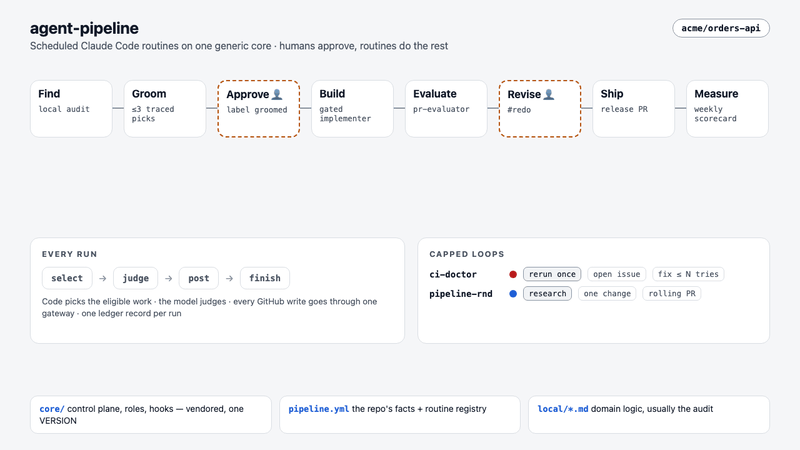

# Agent Pipeline · `agent-pipeline`



*One issue's trip through the pipeline on an example repo: the audit files a finding, grooming proposes it, a
human labels it `groomed`, the implementer opens a PR, the evaluator asks for changes, a human writes `#redo`,
the revised PR is approved, the release PR merges and the weekly scorecard counts it. Every routine run goes
select → judge → post → finish; the two capped loops (`ci-doctor`, `pipeline-rnd`) run beside the flow until the
`agent-pause` label stops them.*

Scheduled Claude Code cloud routines for any repo — audit → groom → gated implement → evaluate → `#redo` →
release PR → weekly scorecard — all run from one vendored generic core (a tested control plane, role prompts,
hooks, a run ledger) plus a per-repo `pipeline.yml` profile. Humans approve the work (`groomed`, `#redo`,
merging); the routines do the rest, and every GitHub write goes through one gateway that adds the AI marker.

## Use it when
- "set up the agent pipeline / routines in this repo"
- "sync routines", "update the pipeline core", "check routine drift"
- "add a local routine", or turning a repo's hand-written routines into the generic core + profile

## What's inside
| Path | What |
|---|---|
| `SKILL.md` | install, sync, update-core and drift workflows |
| `REFERENCE.md` | RemoteTrigger body, hook registration, markers, the ledger, rulesets, setup script |
| `core/` | the vendored control plane (`bin/pipeline.py`), role prompts, shared rules, hooks, `VERSION` |
| `templates/` | `pipeline.yml`, the local audit, the CI proof job |
| `check.py` | profile / install checks (`--doctor`, `--rulesets`) |
| `tests/` | the core's test suite (`pytest tests`) |
| `docs/` | the research behind the design, with sources |

## Install
```bash
npx skills add nicksonthc/claude-skill@agent-pipeline        # or symlink skills/agent-pipeline into ~/.claude/skills
```
