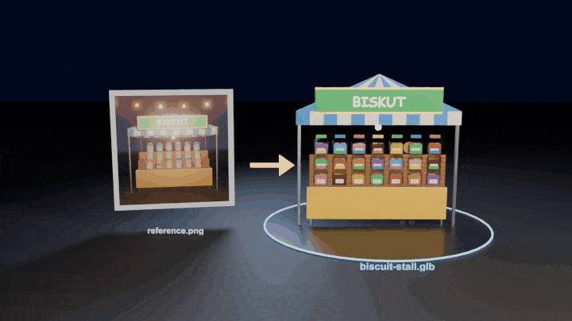

# Image to 3D (Blender) · `image-to-3d-blender`



*Pasar malam demo: a biscuit stall — rows of big glass balang jars with colourful biscuits — growing from a flat reference picture into a 3D model, then a turntable.*

Turns a reference image into a GLB with headless Blender, plus a transparent preview render, an editable .blend and a manifest entry. Flat images (logos, signs, icons) become an extruded silhouette; volumetric subjects (buildings, boats, trees, figures, furniture, street props) become reference-guided procedural studies from a shared helper library. It never claims a faithful reconstruction of geometry the image does not show.

## Use it when
- "craft a 3D object from this image"
- "make a GLB from this picture"
- "build this in Blender"
- batch-modelling a folder of reference images

## What's inside
| File | What |
|---|---|
| `SKILL.md` | routes, workflow, honesty rules |
| `REFERENCE.md` | the studio helper library and recipes |
| `scripts/ · reference/` | headless Blender scripts and reference material |

## Works with
`threejs-glb-viewer` (inspect and gate the export), `r3f-scene-world` (place it in a world).

## Install
```bash
npx skills add nicksonthc/claude-skill@image-to-3d-blender        # or symlink skills/image-to-3d-blender into ~/.claude/skills
```
Claude Code picks it up from the trigger phrases above, or run it directly with `/image-to-3d-blender`.
