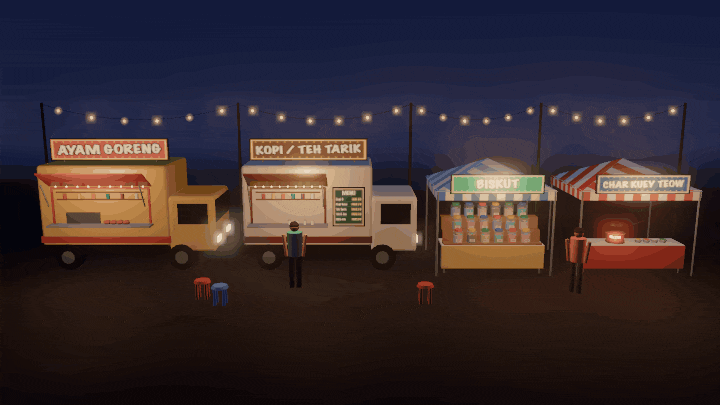

# Interactive 3D Object · `interactive-3d-object`



*Pasar malam demo: hovering along a row of stalls (ayam goreng van, kopi van, biscuit stall, kuey teow stall) — soft hover rings, then a click selects the ayam goreng van with a breathing ring, glow, ripple, particle burst and an "OPEN" label.*

AAA hover/select feedback for objects in a React Three Fiber scene: one design-token file so the feel is coherent and tunable, a status → colour language, a geometry-agnostic ObjectFX overlay (hover ring, breathing status-tinted select ring, click ripple, glow halo, select burst, floating label), a delayed tooltip that stays glued to moving objects, and action-preview telegraphing for HUD buttons.

## Use it when
- making 3D objects hoverable / clickable
- selection rings, glow, highlight, status colours
- object labels and tooltips
- "show what this button will do" previews

## What's inside
| File | What |
|---|---|
| `SKILL.md` | principles, tokens, workflow |
| `REFERENCE.md` | copy-paste ObjectFX, tooltip and token code |

## Works with
`guided-placement` (layers onto its hover/select base), `r3f-hero-camera`, `r3f-scene-world`, `process-sim-3d` (hover/select stations).

## Install
```bash
npx skills add nicksonthc/claude-skill@interactive-3d-object        # or symlink skills/interactive-3d-object into ~/.claude/skills
```
Claude Code picks it up from the trigger phrases above, or run it directly with `/interactive-3d-object`.
