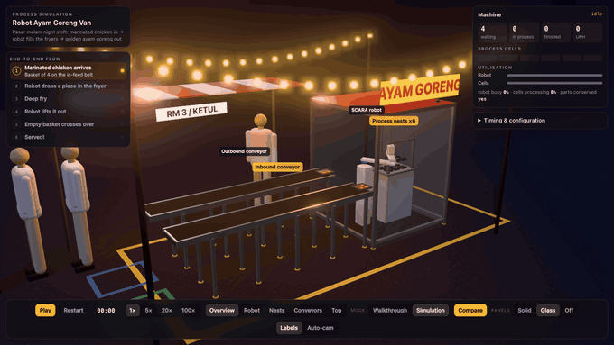

# Process Sim 3D · `process-sim-3d`



*Pasar malam demo: a robot ayam goreng van built with this skill — the template cell re-themed by editing only the spec and the world dressing. Baskets of marinated chicken come in, the SCARA drops pieces into glowing fryers, golden pieces leave for the queue; panels, flow steps and utilisation are generated from the spec. Rendered from the real simulation.*

Turns an engineer's deck (PPT), spreadsheet (Excel) or text description into a browser 3D scene of their process — a quick **walkthrough** (guided camera tour with captions) or a timing-accurate **simulation** (throughput, utilisation, bottleneck, setup comparison, sizing, fill-up time). Everything flows through one reviewed spec file; panels, configuration, views and analysis are generated from it, and only the world builder and the control logic are written per machine. Ships runnable templates for a standalone single HTML file and a React + three.js app, a parametric component library (conveyor, SCARA, gantry, rack, nests, carts, operators, enclosures), a STEP → GLB converter, and a Playwright check tool.

## Use it when
- "simulate this machine / cell / line in 3D"
- "turn this deck / Excel into a 3D walkthrough"
- "how many UPH, where is the bottleneck, do we need a second arm?"
- bringing STEP or GLB equipment models into a process scene

## What's inside
| File | What |
|---|---|
| `SKILL.md` | the workflow: ask mode / stack / language / geometry / hosting, intake → spec → scaffold → geometry → behaviour → panels → analysis → verify → deliver |
| `references/` | intake, spec schema, engine patterns, components, CAD (STEP/GLB + refused formats), visuals, panels, analysis, verification, stacks + hosting, pitfalls |
| `templates/` | shared core + components + demo sim, standalone shell, React shell, tools/check.mjs — both stacks build and pass the checks |
| `scripts/step2glb.py` | STEP → GLB, one node per solid, metres, Y-up (CadQuery 2.5) |
| `examples/burn-in-cell/` | the burn-in cell project this was harvested from, with its results |

## Works with
`threejs-glb-viewer` (inspect a GLB before placing it), `threejs-realism` (photoreal pass), `r3f-hero-camera` (cinematic shots), `interactive-3d-object` (hover/select stations), `dataviz` (charts).

## Install
```bash
npx skills add nicksonthc/claude-skill@process-sim-3d        # or symlink skills/process-sim-3d into ~/.claude/skills
```
Claude Code picks it up from the trigger phrases above, or run it directly with `/process-sim-3d`.
