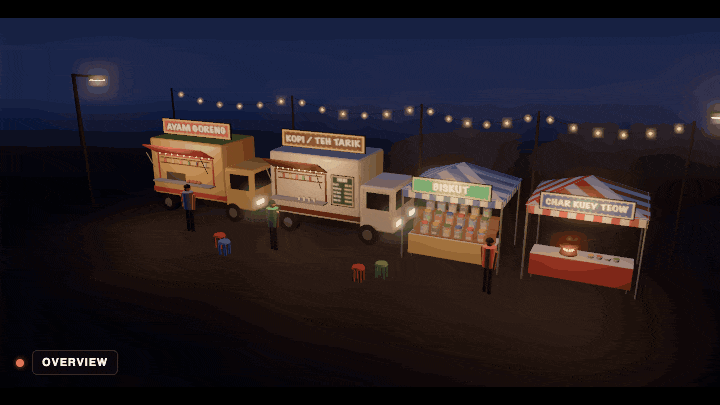

# R3F Hero Camera · `r3f-hero-camera`



*Pasar malam demo: a shot sequence over a row of stalls — overview, 3/4 framing on the kopi van, punch-in on its menu board, and back out.*

A cinematic camera rig for React Three Fiber on drei CameraControls: a reusable shot vocabulary (overview, 3/4 object framing, screen punch-in, first-person standpoint, chase engage), a stutter-free follow cam, an idle attract orbit that breaks on user input, perspective ↔ orthographic switching, and a writer-priority ladder so competing camera drivers never fight.

## Use it when
- fly-to / framing on selection, a "focus on X" button
- follow or chase cameras
- cinematic tour or demo beats, idle attract loops
- a top-down ortho editor view

## What's inside
| File | What |
|---|---|
| `SKILL.md` | shot vocabulary, priority ladder, pitfalls |
| `REFERENCE.md` | copy-paste rig code |

## Works with
`guided-placement`, `interactive-3d-object`, `r3f-scene-world`, `process-sim-3d` (tour shots).

## Install
```bash
npx skills add nicksonthc/claude-skill@r3f-hero-camera        # or symlink skills/r3f-hero-camera into ~/.claude/skills
```
Claude Code picks it up from the trigger phrases above, or run it directly with `/r3f-hero-camera`.
