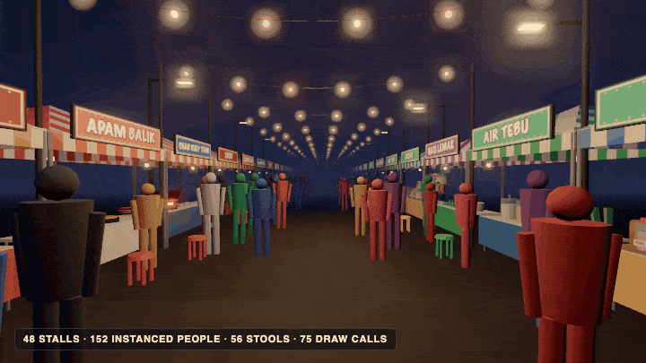

# R3F Scene World · `r3f-scene-world`



*Pasar malam demo: a first-person walk down a whole night-market street — two rows of canopy stalls, string lights, lamps, stools and an instanced crowd.*

Builds and maintains a large hand-authored React Three Fiber world: one deformable authoring frame shared by procedural geometry, placed GLB models, scattered instances and camera routes; tens of thousands of primitives merged into a few draw calls; an instanced-vegetation triangle budget; a store / useFrame split that keeps per-frame values out of React; a scripted first-person route with one camera owner; one-state weather; and Playwright stills + clearance sweeps.

## Use it when
- building a town, landscape, campus, factory or level scene
- placing many GLB models from config, scattering props by rule
- a guided walkthrough or fly-through
- a big R3F scene that has become slow or tangled

## What's inside
| File | What |
|---|---|
| `SKILL.md` | the authoring frame, budgets, route, weather, checks |
| `REFERENCE.md` | copy-paste building blocks |

## Works with
`image-to-3d-blender` (GLB authoring), `r3f-hero-camera`, `interactive-3d-object`, `guided-placement`.

## Install
```bash
npx skills add nicksonthc/claude-skill@r3f-scene-world        # or symlink skills/r3f-scene-world into ~/.claude/skills
```
Claude Code picks it up from the trigger phrases above, or run it directly with `/r3f-scene-world`.
