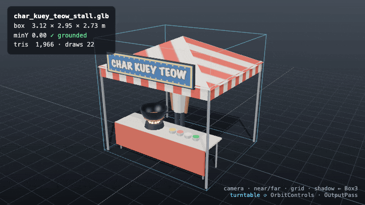

# three.js GLB Viewer · `threejs-glb-viewer`



*Pasar malam demo: a char kuey teow wok stall on a turntable — framed from its measured bounding box, soft ground shadow and grid, the way the viewer frames any GLB.*

Shows a Blender-exported GLB honestly on a web page: a zero-dependency GLB report (bounding box, triangles, draw calls, required decoders), a self-contained single-file viewer that frames itself from the model's measured box, GLTFLoader with DRACO / KTX2 / Meshopt, OrbitControls, and an EffectComposer stack whose OutputPass keeps colours matching Blender. Manifest gallery mode and an export gate catch bad exports.

## Use it when
- "show this model in three.js"
- "build a model viewer / turntable"
- a GLB that comes out black, washed out, tiny, off-centre or upside down
- a gallery of models from a manifest

## What's inside
| File | What |
|---|---|
| `SKILL.md` | the measure-then-derive discipline, workflow, pitfalls |
| `REFERENCE.md` | copy-paste viewer code for three.js and R3F |
| `scripts/` | GLB report and viewer tooling |

## Works with
`image-to-3d-blender` (makes the GLBs), `threejs-realism` (look pass), `process-sim-3d` (places GLBs into process scenes).

## Install
```bash
npx skills add nicksonthc/claude-skill@threejs-glb-viewer        # or symlink skills/threejs-glb-viewer into ~/.claude/skills
```
Claude Code picks it up from the trigger phrases above, or run it directly with `/threejs-glb-viewer`.
