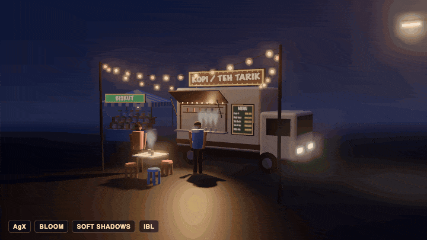

# three.js Realism · `threejs-realism`



*Pasar malam demo: a kopi & teh tarik van at night — warm string lights, bloom, soft shadows and steam, with a slow dolly-in.*

Takes a Blender scene or GLB (buildings, warehouses, factories, rooms, props) to an ultra-realistic three.js scene and critiques it in a screenshot-driven loop: a headless Blender realism pass (real-world scale, bevels, PBR texture sets, baked lightmaps), GLB optimisation, a tuned WebGL viewer (HDRI, AgX tone mapping, shadows, GTAO, bloom, SMAA, procedural weathering), automated Playwright screenshots and a structured visual critique.

## Use it when
- "make it look real / polish this scene"
- "critique this render"
- baking lighting for a GLB
- a WebGL viewer that looks photographic

## What's inside
| File | What |
|---|---|
| `SKILL.md` | the realism loop and critique rubric |
| `references/` | lighting, materials, post-processing, critique |
| `scripts/` | Blender passes, viewer, screenshot tooling |

## Works with
`threejs-glb-viewer`, `image-to-3d-blender`, `process-sim-3d` (look pass for a sim scene).

## Install
```bash
npx skills add nicksonthc/claude-skill@threejs-realism        # or symlink skills/threejs-realism into ~/.claude/skills
```
Claude Code picks it up from the trigger phrases above, or run it directly with `/threejs-realism`.
